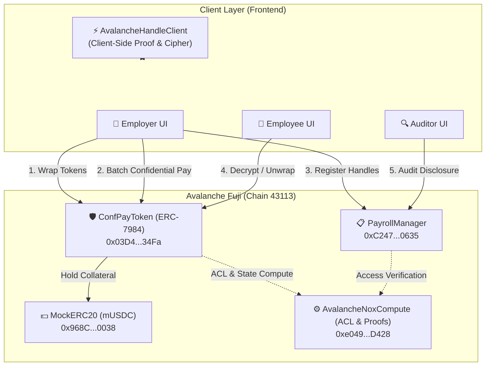
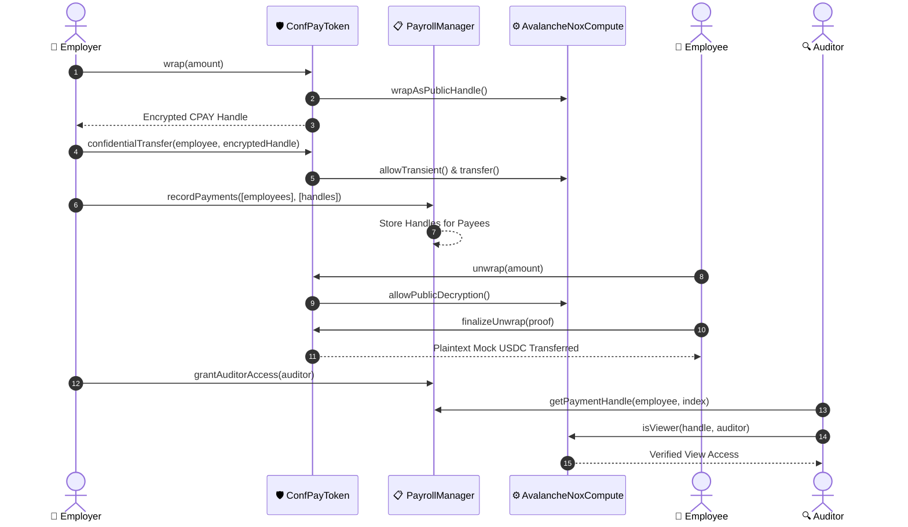

# AVApulse: Confidential Payroll Protocol on Avalanche Fuji

> Built by **ElonCoding** | Native ERC-7984 Confidential Layer on Avalanche C-Chain

---

## ⚡ Overview

**AVApulse** solves the public compensation paradox in Web3. Public blockchains expose salaries, bonuses, and contractor payments to the entire world. AVApulse leverages **ERC-7984 confidential token wrapping** paired with **on-chain ACL computation (AvalancheNoxCompute)** on Avalanche Fuji to deliver completely private balances and encrypted payouts with selective, regulatory-compliant auditor disclosure.

---

## 🏗️ System Architecture



---

## 🔄 Confidential Batch Payroll Lifecycle



---

## 📜 Deployed Contracts on Avalanche Fuji

| Contract | Address | Network | Explorer |
| :--- | :--- | :--- | :--- |
| **MockERC20 (mUSDC)** | `0x968C84e7549020fF4dA1c6E2B0fc459f2ED90038` | Avalanche Fuji (43113) | [Snowtrace](https://testnet.snowtrace.io/address/0x968C84e7549020fF4dA1c6E2B0fc459f2ED90038) |
| **ConfPayToken (CPAY)** | `0x03D47783137398bafF49B441dF063016984234Fa` | Avalanche Fuji (43113) | [Snowtrace](https://testnet.snowtrace.io/address/0x03D47783137398bafF49B441dF063016984234Fa) |
| **PayrollManager** | `0xC247661F01b9c5aFCe6C2CA0bcB8Fc6273680635` | Avalanche Fuji (43113) | [Snowtrace](https://testnet.snowtrace.io/address/0xC247661F01b9c5aFCe6C2CA0bcB8Fc6273680635) |
| **AvalancheNoxCompute**| `0xe0493eE9fE6513e5ddc3aa3Cc50845FD0591D428` | Avalanche Fuji (43113) | [Snowtrace](https://testnet.snowtrace.io/address/0xe0493eE9fE6513e5ddc3aa3Cc50845FD0591D428) |

---

## 🛠️ Project Structure

```
AVApulse/
├── LICENSE                    # MIT License (ElonCoding)
├── README.md                  # Comprehensive documentation & architecture
├── docs/                      # Technical specifications & design docs
│   ├── ARCHITECTURE.md        # Deep dive into cryptographic ACL & wrapping
│   ├── DEPLOYMENT_GUIDE.md    # Fuji deployment & configuration handbook
│   ├── API_REFERENCE.md       # Smart contract interfaces and function specs
│   └── SECURITY_MODEL.md      # Access control & confidential computation model
├── deployments/
│   └── avalanche-fuji.json    # Verified deployed addresses and deployment parameters
├── code/
│   ├── hardhat.config.js      # Hardhat config tuned for Avalanche Fuji (Solidity 0.8.35)
│   ├── .env.example           # Environment template with prefilled live contract addresses
│   ├── contracts/             # Solidity 0.8.35 smart contracts
│   │   ├── ConfPayToken.sol   # ERC-7984 confidential wrapper
│   │   ├── MockERC20.sol      # Test collateral token
│   │   ├── PayrollManager.sol # Role management and auditor registry
│   │   └── AvalancheNoxCompute.sol # Native Avalanche ACL & compute engine
│   ├── scripts/               # Automation & deployment pipelines
│   │   ├── deploy.js          # Main deploy script for Token & Wrapper
│   │   ├── deploy-payroll.js  # PayrollManager deployment & seeding
│   │   └── deploy-compute.js  # Native Avalanche compute deploy script
│   └── frontend/              # React 19 + Vite 8 frontend dApp
│       ├── src/
│       │   ├── config/contracts.js # Contract ABIs and Avalanche Fuji addresses
│       │   ├── services/avalancheHandle.js # Zero-gateway off-chain proof client
│       │   ├── pages/         # Employer, Employee, Auditor dashboards
│       │   └── context/WalletContext.jsx # Avalanche wallet provider
│       └── scripts/test-live.mjs # 4-stage automated on-chain verification
```

---

## 🚀 Quickstart Guide

### 1. Prerequisites
- Node.js ≥ 18
- MetaMask configured for Avalanche Fuji Testnet
- Test AVAX from the [Avalanche Faucet](https://faucet.avax.network/)

### 2. Installation
```bash
git clone https://github.com/ElonCoding/AVApulse.git
cd AVApulse/code

# Install contract dependencies
npm install

# Install frontend dependencies
cd frontend
npm install
```

### 3. Verification Suite
Verify live Fuji contracts directly from your terminal:
```bash
cd code/frontend
node scripts/test-live.mjs
```

### 4. Run Frontend Locally
```bash
cd code/frontend
npm run dev
```
Open `http://localhost:5173` and connect your MetaMask wallet on Avalanche Fuji.

---

## 🔒 Security & Privacy Model

- **Encrypted Salary Handles**: Salary amounts never hit the blockchain in plaintext. They exist only as 32-byte encrypted scalar handles.
- **Role-Based Access Lists (ACL)**: `AvalancheNoxCompute` checks on-chain transient and persistent authorization before any handle can be transferred or decrypted.
- **Selective Auditor Disclosure**: The employer can grant specific third-party auditors view access to historical payroll handles without leaking keys or exposing plaintext balances to other employees.

---

## 📄 License

MIT License. Copyright (c) 2026 **ElonCoding**. See [LICENSE](LICENSE) for details.
